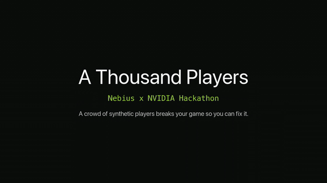
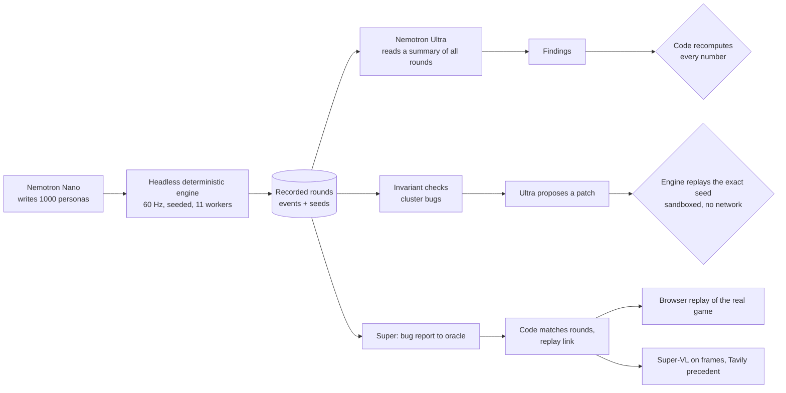
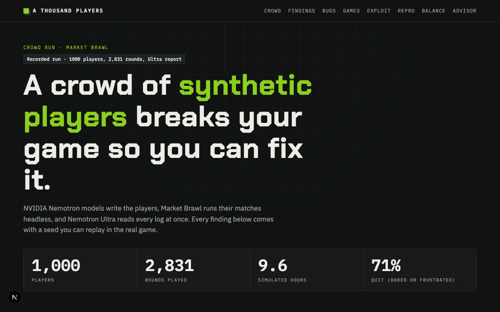
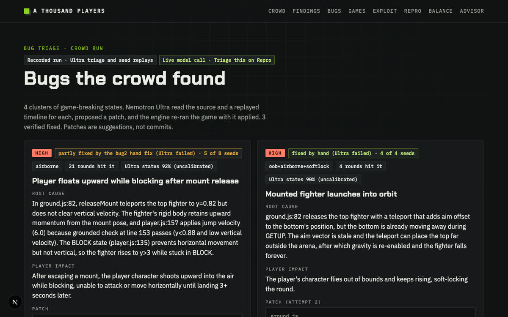
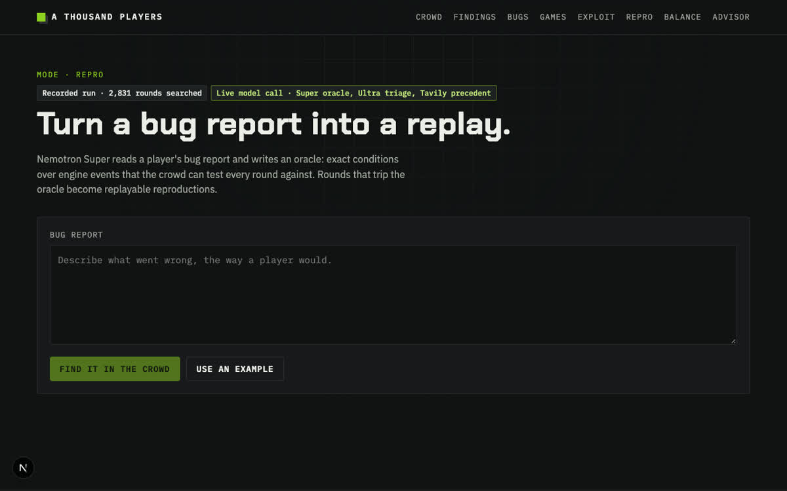
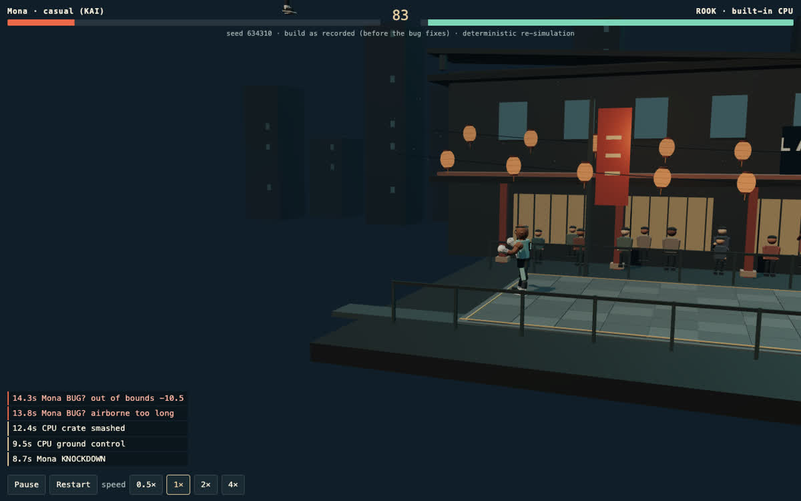
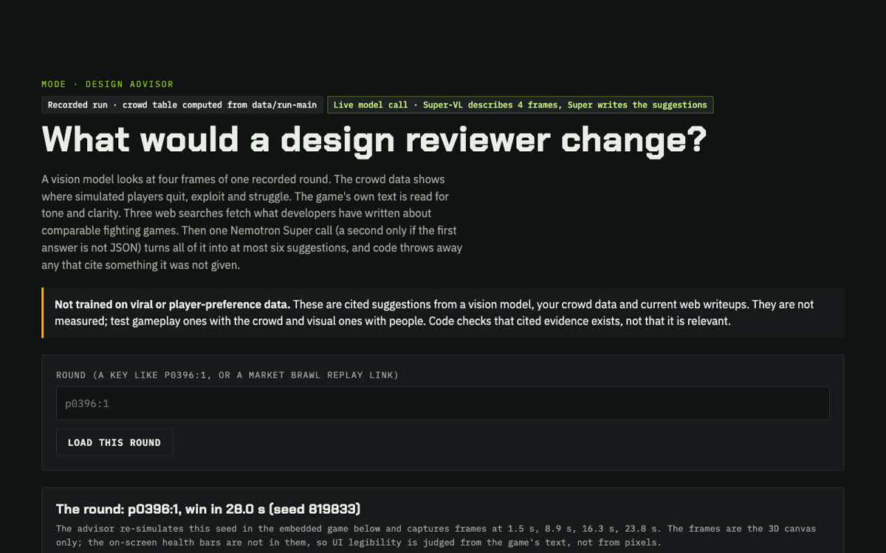
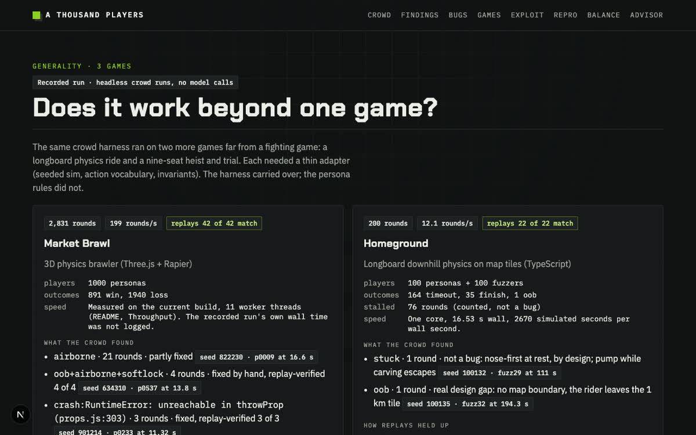

# A Thousand Players

> A crowd of synthetic players, written by Nemotron, plays your browser game by the thousand, finds where it breaks, and backs every finding with a seed you can replay in the real game.



[](LICENSE) [](THIRD-PARTY.md)   

**Demo video (2:47):** [https://youtu.be/tKOsGMdRnNc](https://youtu.be/tKOsGMdRnNc). **Live demo:** https://a-thousand-players.vercel.app (no login). **Proof the bugs were real and are fixed:** [docs/PROOF.md](docs/PROOF.md) (same seed replayed before and after each fix, with frames and engine numbers). A silent 24-second preview is above.

Built for the Nebius x NVIDIA Global AI Hackathon. The test bed is **Market Brawl**, Parth's own CSCI 310 course-project 3D fighting game (Three.js + Rapier), copied into `game/` with small changes: a rules file for tuning, five bug fixes that can each be switched off so recorded rounds still replay as recorded, and a CPU low-block balance rule (default on). Two more games (Homeground and Clean Getaway) run through the same crowd harness under `adapters/` (Clean Getaway is a private repository, so its adapter runs only with a local checkout of it). All models run on Nebius Token Factory; Tavily does the web search.

## Contents

[Start here](#start-here-two-minutes) · [Quick start](#quick-start) · [How it works](#how-it-works) · [What it does](#what-it-does) · [Screenshots](#screenshots) · [Results](#results-from-the-main-run) · [Honest limits](#honest-limits) · [Model roles](#model-roles) · [Design Advisor](#design-advisor-modesadvisor) · [Testing](#testing) · [Running it](#running-it) · [Layout](#layout) · [License](#license)

## Quick start

```bash
git clone https://github.com/Ps23102004/a-thousand-players && cd a-thousand-players
npm ci
cp .env.example .env        # optional: add NEBIUS_API_KEY and TAVILY_API_KEY for the live model calls
npm run dev                 # http://localhost:3000   (predev syncs the game into public/)
```

Without keys the app still runs: every recorded page works and model routes answer "not configured". Patch Prophet needs no key. `npm test` runs the whole suite offline.

## How it works



Models propose; code checks. Every number on a finding is recomputed from the raw runs, and every fix verdict comes from replaying the exact seed, never from the model's own confidence.

## Start here (two minutes)

1. Open the home page: the crowd grid replays recorded rounds, and the findings carry their verified claims. Each page is tagged **Recorded run** or **Live model call**.
2. Open **Repro**, press **Use an example**, then **Find it in the crowd**. Super writes an oracle live and code finds the two recorded rounds with that bug. Press **Triage this (Ultra)** on a match for a live root cause, patch and replay verdict.
3. Press a seed's replay link: the real game re-simulates that exact round in your browser and shows the bug.
4. Open **Bugs** for the four clusters and what happened to each fix.

If the rate limit is reached, the built-in examples on Repro and Balance return the real answer recorded for them, marked as cached. Other inputs get a 429. Patch Prophet also has a cached fallback for the exact example tuning if it is rate limited, busy or times out.

## Who it is for

Small game teams that have no QA department: a crowd of synthetic players finds where the game breaks or frustrates, and every claim comes with a seed that replays the exact round. Other commercial tools use AI agents to play-test games; this project differs in being open source, in proving each finding with a deterministic replay, and in checking the model's claims with code instead of trusting them. The full pipeline runs on one game so far (Market Brawl), so it is a working prototype, not a product.

## What it does

1. **Personas.** Nemotron Nano writes 1000 player personas (archetype, skill, reaction time, patience, frustration tolerance, a short bio, and sparse decision rules). A validator rejects bad ones and a repair loop asks for replacements. (That run's 69 Nano calls predate usage logging, so `usage.json` undercounts Nano.)
2. **Crowd.** A headless, deterministic copy of the game (`engine/`) plays every persona for 1 to 5 rounds against the game's own CPU rival, at 60 Hz with no renderer, across all CPU cores. A simple mood model decides when a player quits from frustration or boredom.
3. **Report.** Nemotron Ultra reads a summary of all 2,831 rounds in one context (one line per player, with per-round events trimmed to fit the budget; see Honest limits) and returns findings. Each finding has structured claims and the seeds of rounds that show it. Code then recomputes every claim from the raw runs and removes any seed that does not exist.
4. **Bug triage.** Invariant checks in the engine (`engine/bugs.mjs`) group broken rounds into bug clusters. Ultra proposes a root cause and a patch. `engine/verify-fix.mjs` applies the patch to a scratch copy of the game, replays the exact seeds, and runs a regression crowd.
5. **Exploit search.** Nano proposes bot strategies, the engine plays each one, Nano evolves the best ones, and Super writes an explanation of why they win.
6. **Repro.** A player writes a bug report in plain English. Nemotron Super turns it into an oracle, a predicate over the engine's event log. Plain code (`lib/oracle.ts`, no model) runs the oracle over all 2831 recorded rounds and links the rounds that trip it. The sample report about floating up and leaving the arena found exactly the two recorded rounds with that bug. Zero matches does not prove a bug is absent, and the model's oracle varies a little between calls.
7. **Eyes.** On any replay page, a button captures three frames from the embedded 3D game (around the round's first bug event, if it has one), shrinks them to 640 px JPEGs and asks Nemotron Super-VL what it sees. It is a description aid: the engine's invariant checks decide what counts as a bug.
8. **Balance / Patch Prophet.** Super translates patch notes into tuning values checked against the allowed ranges. **Run Patch Prophet** then compares the recorded tuning with the new tuning live, using sequential child processes. Both sides use the same 200 personas and seeds, one round each. The page labels this as a sample and provides a cached fallback for the exact example tuning. Prophet adds no model call beyond the existing Super translation ([details](docs/prophet.md)).
9. **Replay.** Any round can be re-run in the real 3D game in the browser from its seed. The recorded rounds predate the mount-release fix (`rules.mountReleaseFix`), so their links carry that setting off and the replay shows the bug as recorded; 45 of 45 sampled recorded rounds, including the three crash rounds, replay event for event that way (`node scripts/check-recorded-replays.mjs`).
10. **Game UI and controls crawler.** The `/games` block shows **92 of 92 controls work**: HUD buttons, guide keys and an injected fake gamepad, with stronger preconditions after a reviewer found 7 weak checks (fixed). A deliberately broken pause button fails the crawler. No broken control was found, so nothing was fixed. Physical controller hardware is untested ([spec](e2e/game-ui.spec.cjs), [report](docs/controls-report.json), [notes](docs/controls.md)).
11. **Glitch Hunter.** The `/bugs` block reports a Super-VL second opinion on engine-flagged rounds: 10 flagged + 10 matched clean rounds, 20 calls. Hit rate: **8/10** (Wilson 95% interval **49.0–94.3%**); false-alarm rate: **2/10** (**5.7–51.0%**). The recorded run has only 10 flagged rounds of the requested types. The engine remains the detector ([batch notes](docs/glitch-hunt.md), [results](data/glitch-hunt/results.json)).
12. **Spec Drift (`/modes/drift`).** One Nemotron Ultra call (about 32K estimated prompt tokens) over `docs/design.md`, `game/README.md` and the game source proposed 8 doc-vs-code drift claims; code verified for all 8 that the quoted text exists verbatim in the named doc and the symbol exists in the named code file ("8 of 8 verified, 0 dropped"; existence checks only). A second model (Gemini 3.8 Flash, read-only) judged them: 3 real drift, 1 vague doc wording, 4 not drift. The page shows second-model-confirmed ones first. One run; the judge is a second opinion, not ground truth. No doc or code was changed because of it ([notes](docs/drift.md), [results](data/drift/results.json), [judge](data/drift/judge.json)).
13. **ReproBot fresh-play (two runs, local Gemma player, not Nemotron).** A small local model (`gemma4:e4b-mlx`, no per-call cost) played 20 fresh seeds per arm and the oracle stopped each round on a match. For the **rare** example bug report (4 of 2,831 recorded rounds, so about a 2.8% chance of a single hit in 20 rounds) it reproduced **0 of 20** on the recorded build, 0 of 20 on the shipped build and 0 of 20 for a no-model baseline: that shows nothing, by construction. For a **common** report (the player is knocked down in the first 30 s) it reproduced **19 of 20** on the recorded build, **19 of 20** on the shipped build and 20 of 20 for the no-model baseline: the pipeline works end to end, but a model-driven player was not better than the scripted baseline. The local player fell back to a default move on 23% (recorded, rare) and 33% (shipped, rare) of its calls ([notes](docs/reprobot.md), `data/reprobot/results.json`, `data/reprobot/results-common.json`). The earlier Nemotron Nano attempt hit its 40-call budget after 2 rounds and is superseded.
14. **Review-grounded Design Advisor (`/modes/advisor`).** Grounded in a committed corpus of 12 short quotes (<= 300 chars) with URLs from public review pages (IGN 4, Reddit 3, GameSpot 3, Steam 2), collected with 12 Tavily searches (`data/reviews/corpus.json`, `docs/reviews.md`). The Advisor can cite them as "player opinion"; code drops any citation not in the corpus and any "players say/like" claim without a citation. Quotes are search snippets from many games, not only fighting games. Topic tags are keyword guesses and can be wrong; sentiment is NOT used. Retrieval with attribution, nothing was trained or fine-tuned.
15. **Tutorial Director (`/modes/onboarding`).** Displays a struggle table computed from the recorded run (casual players: 5.9% round win rate, 97% quit) and 3 onboarding aids drafted by one Nemotron Super call, each measured with the Patch Prophet paired crowd (200 personas, 1 round, seed 1): overall wins of 200 before to after: 66 to 75, 66 to 69, 66 to 60; casual wins of 39: 5 to 9, 5 to 8, 5 to 5. One seed, within noise, round 1 only, quit model not re-simulated, no real new players. It shows what changes in win rates, not that any tip teaches anything ([notes](docs/tutor.md), [results](data/tutor/results.json)).

- **Black-box mode.** Watch a browser game URL with screenshots and recorded inputs, without importing its source; evidence is observational ([guide and limits](docs/blackbox.md)).

## Screenshots

| Findings and the crowd | Bugs and fix verdicts |
|---|---|
|  |  |
| **Repro: bug report to replayable rounds** | **Replay: the real game shows the bug** |
|  |  |
| **Design Advisor (cited suggestions)** | **Three games** |
|  |  |

## Results from the main run

All numbers below come from files in `data/run-main/`.

- **Crowd** (`summary.json`): 1000 players, 1000 sessions, 2831 rounds, 891 wins and 1940 losses for the players (win rate 31.5%). Session end reasons: 708 frustration, 250 satisfied, 42 hit the round cap.
- **Throughput** (measured 2026-10-28, `node engine/crowd.mjs --personas data/run-main/personas.json --out .work/tp --traces 0`): 1000 players, 2,829 rounds in 14.2 s on 11 worker threads of a 12-core Mac, 199 rounds per second, 0 game crashes. This is the current game build with the bug2 and bug3 fixes, so it differs slightly from the recorded 2,831 rounds.
- **Report** (`findings.json`): Ultra read the whole crowd in one call (220,334 prompt tokens including the system prompt; the corpus estimate was 219,064; 4,439 tokens out) and returned 8 findings. **31 of 31 structured claims matched the recomputed value. 13 cited seeds did not exist in the runs and were dropped or repaired from the cited player and round (`ai/verify.ts`); the split was not stored.**
- **Bug triage** (`triage.json`, `fixes/`): 4 bug clusters.

  | Cluster | Signature | Rounds | Result |
  |---|---|---|---|
  | bug4 | `stuck:KNOCKDOWN+airborne+softlock` | 1 | **Ultra's patch fixed 1 of 1 seeds but is not shipped** (it removes a height guard entirely). Seed 529060 ran to the 99 s time limit before the patch and ends by KO at 18.73 s with no bug events after it. Regression crowd of 200 personas: bug rounds 4 before, 3 after. A narrower hand fix, `rules.knockdownOnPropFix` (docs/bug-hunt.md H3: FALL also ends once the body is at rest), is shipped, and the bug4 seed replays clean on the shipped game (KO at 18.9 s, 0 bug events; with the rule off it runs to 99 s with 3). |
  | bug1 | `airborne` | 21 | Ultra's patch fixed 0 of 8 replayed rounds. **The shipped game replays all 21 clean** with all hand fixes together (`mountReleaseFix`, `grabReleaseFix`, and `getupCrateFix`, alongside shipped engine guards). The 21 rounds spanned distinct root causes without a single fix resolving them all: mount releases, grab collisions, and getup ejection beside a crate on p0094:1 (seed 501070, sweep-nerf, where `getupCrateFix` refreshes contacts near intact props). Former crash round p0047:1 also depends on `throwPropGuard`. Checked with `node scripts/proof-table.mjs`. |
  | bug2 | `oob+airborne+softlock` | 4 | **Fixed by hand, replay-verified, 4 of 4.** Ultra's patch failed twice (0 of 4; its "stale aim offset" guess was wrong). Tracing the seed tick by tick found two causes, both in `releaseMount`: (1) the top fighter was placed inside a crate beside the wall and ejected upward at 7.7 m/s; it now lands on the first side that is clear of crates. (2) After the mount a fighter that had been held still sank through the floor for 0.3 s and was then thrown upward against the wall; a `sleep()` then `wakeUp()` at release stops it. Cause (2) is a workaround: the fighter then rests 0.07 m low, and why the contact goes stale is not understood. Regression crowd of 200 personas: bug rounds 4 before, 1 after; win rate 0.314 to 0.300 because trajectories changed. |
  | bug3 | `crash: RuntimeError: unreachable in throwProp (props.js:303)` | 3 | **Fixed and replay-verified, 3 of 3 seeds.** Ultra guarded `throwProp` against a prop whose body was already freed. The first two triage runs failed because Ultra ignored the answer format; adding a concrete format example to the prompt fixed that. The regression crowd (200 personas) did not contain this crash, so it shows no change (4 bug rounds before and after). |

- **Exploit search** (`exploit.json`): 32 strategies over 2 generations, 30 rounds each (960 rounds). The best strategy ("Mid Grapple Cheese") won 30 of 30 rounds (win rate 1.0) against the CPU. The recorded hits show how: 117 SWEEP hits, 49 GROUND strikes. Every top strategy wins the same way, sweep (which the CPU never crouch-blocks) into knockdown into mount, whatever Nano's rule text said it was doing.

Patch Prophet measurements are separate from the main run: the example tuning gave **66 → 69 wins out of 200** on seed 1 and **55 → 64** on seed 2 ([notes](docs/prophet.md), [seed 1](data/prophet/example.json), [seed 2](data/prophet/seed-2.json)). A hosted run with different tuning took **36.7 s**, with **66/200** wins before and **62/200** after ([hosted smoke](docs/evidence/hosted-smoke-2026-10-29.md)). That was one hosted run.

## Honest limits

- **Black-box runs cannot guarantee replay.** See [black-box limits](docs/blackbox.md#limits).

- **Patch Prophet is a sample.** It uses the first 200 recorded personas, one round each, with paired seeds. Two seeds do not establish statistical significance or human preference. It does not rerun the full 1000-player crowd.
- **Still not built.** Mechanic Forge, ModForge, SightGuide, SimDojo. Bully (Unreal) and GTA were not tested. Repro searches recorded rounds.
- **Spec Drift checked existence only.** Code verified that quotes exist in docs and symbols exist in code (8 of 8), but not semantic correctness. The Gemini 3.8 Flash judge is a second opinion (3 real drift, 1 vague doc wording, 4 not drift), not ground truth. One run; no doc or code was changed because of it.
- **ReproBot fresh-play: no evidence that a model-driven player beats a scripted one.** A small local model (`gemma4:e4b-mlx`, no per-call cost) played 20 fresh seeds per arm and the oracle stopped each round on a match. For the **rare** example bug report (4 of 2,831 recorded rounds, so about a 2.8% chance of a single hit in 20 rounds) it reproduced **0 of 20** on the recorded build, 0 of 20 on the shipped build and 0 of 20 for a no-model baseline: that shows nothing, by construction. For a **common** report (the player is knocked down in the first 30 s) it reproduced **19 of 20** on the recorded build, **19 of 20** on the shipped build and 20 of 20 for the no-model baseline: the pipeline works end to end, but a model-driven player was not better than the scripted baseline. The local player fell back to a default move on 23% (recorded, rare) and 33% (shipped, rare) of its calls ([notes](docs/reprobot.md), `data/reprobot/results.json`, `data/reprobot/results-common.json`). The earlier Nemotron Nano attempt hit its 40-call budget after 2 rounds and is superseded.
- **Advisor review corpus is search snippets.** 12 short quotes (<= 300 chars) from public review pages across many games, not only fighting games. Topic tags are keyword guesses and can be wrong; sentiment is NOT used. Retrieval with attribution, nothing was trained or fine-tuned.
- **Tutorial Director measures tuning noise, not teaching.** 3 onboarding aids drafted by Super, measured on one seed (200 personas, round 1 only). Win rate shifts (overall 66 to 75, 69, 60; casual 5 to 9, 8, 5) are within noise. The quit model was not re-simulated, and no real new players participated. It shows what changes in win rates, not that any tip teaches anything.
- **Players are synthetic.** Quit and boredom come from a simple mood model with Nano-written traits. It generates hypotheses; it does not replace human playtesters.
- **Crowd players are not LLM-driven move by move.** Nano writes each persona's policy, and the engine runs that policy natively. Driving all 1000 players with model calls on every decision was measured as too slow and too costly. The live "spotlight" player (`ai/spotlight.ts`, Nano picks each action) is implemented and measured but is not part of the main crowd run.
- **Findings are sampled, not proofs of absence.** If the crowd did not hit a bug, that does not mean the bug is not there.
- **Only the claims and seeds are machine-checked.** Ultra's prose can still contain wrong numbers. On a test fixture it wrote "10/18 Round 1s end in draws" when there were 3. Trust the verified claims, not the narrative.
- **Super's exploit explanation was wrong until it was grounded.** Given only the strategies' rule text and the CPU code, Super explained the wins as "recovery-state grabs". The recorded hits say sweep into mount. The prompt now includes the measured hit tally per strategy, and the `explanation` field starts with that tally, written by code. Super's prose after it names the sweep and the guard rule, but still over-reads the grabs.
- **Super-VL is a description aid, not a detector.** On the first demo round (seed 634310) it said nothing was floating because the camera pulls back and the fighters are tiny. An earlier 6-round test flagged 3 of 3 bug rounds and 0 of 3 clean rounds, naming the real bug in 2 (docs/calibration.md). The later Glitch Hunter batch scored 8/10 flagged and 2/10 false alarms, with wide intervals (docs/glitch-hunt.md). The engine's invariant checks decide what is a bug. Clean means no recorded invariant event, not proof of absence.
- **Part of the cheeser story is built in.** The cheeser archetype's base table already favors sweeps (`engine/policy.mjs`), so "cheesers win 92% by sweep" is partly the author's table. What the crowd and the exploit search found independently is that the recorded CPU never crouch-blocked and answered crouching recovery with high attacks that missed. The shipped CPU now uses the low-block balance rule.
- **"31 of 31 claims verified" checks the report against code-computed tables.** Ultra's claims are rates by archetype and round, which code also computes for the prompt header, so the check proves Ultra read the numbers correctly, not that it discovered them. The stronger test is the planted fixture: four stories hidden in 1000 players, all four found.
- **Fix status in the shipped game.** Five rule fixes are in `game/src`, each behind a rule (default on) so recorded rounds still replay as recorded: `mountReleaseFix` (bug2, by hand), `throwPropGuard` (bug3, Ultra's patch), `grabReleaseFix` (bug1, by hand), `knockdownOnPropFix` (bug4, a narrower hand fix) and `getupCrateFix` (bug1's remaining getup beside a crate, by hand). `cpuLowBlock` also defaults to 1 as a balance change: the CPU crouch-blocks low attacks and answers crouching recovery with a sweep; recorded rounds pin it to 0. The 100-seed sweep cuts crouch-jab wins from 100/100 to 0/100 and all-keys wins from 100/100 to 40/100, at a crowd win-rate cost of 31.0% to 23.5% (casual: 5/39 at both). See [the decision](docs/cpu-lowblock.md#decision). Ultra's own bug4 patch removes a height guard entirely and is not shipped; Ultra's bug1 patch fixed 0 of 8. All 29 flagged rounds (21 bug1, 4 bug2, 3 bug3, 1 bug4) replay clean on the shipped game.
- **Ultra reads a summary, not every play log.** Per-round timed events (knockdown, throw, prop, mount) were trimmed to fit the 220,000-token budget: with the current `ai/corpus.ts`, 989 players are shown without timed events and 11 with outcome only (0 omitted; the aggregates cover all 2,831 rounds). The 989 keep their bug events; the 11 outcome-only players show results only.
- **The rate limit is per server instance.** Counts live in memory, so on Vercel each instance has its own counts: 10 requests per minute per address on every route, plus a daily cap per route (`lib/ai-route.ts`: repro 80, balance 40, eyes 40, triage 40, precedent 100, advisor 20; Prophet has its own 40/day cap, one live comparison per instance and a 100-second child-work deadline in `lib/prophet.ts`). The cached example answers keep the demo working when a limit is hit.
- **Full pipeline on one game.** The full pipeline (Ultra report, triage, Repro, Eyes) runs on Market Brawl only. Homeground and Clean Getaway have crowd-harness adapters only (see `docs/generality.md`).
- **Prices are estimates.** Only Ultra has a dollar estimate, at an unverified aggregator price ($1/M input, $3/M output). Other models report tokens only.

## Design Advisor (`/modes/advisor`)

Captures 4 frames of one recorded round, has Nemotron Super-VL describe the visual design (lighting, readability, camera, clutter), builds a crowd evidence table with code (quit and win rate by archetype, the round-2 to round-3 drop, the sweep nerf, bug counts, the CPU low-block rule), reads the game's own text, runs 3 Tavily searches limited to developer and design sites (the server words the queries; nothing from the client), and makes one Nemotron Super call (thinking off) that writes at most 6 recommendations as JSON. A committed corpus of 12 short quotes (<= 300 chars) with URLs from public review pages (IGN 4, Reddit 3, GameSpot 3, Steam 2) was collected with 12 Tavily searches (`data/reviews/corpus.json`, `docs/reviews.md`). The Advisor can cite them as "player opinion"; code drops any citation not in the corpus and any "players say/like" claim without a citation. Quotes are search snippets from many games, not only fighting games. Topic tags are keyword guesses and can be wrong; sentiment is NOT used. Retrieval with attribution, nothing was trained or fine-tuned. Code then checks each recommendation. It drops one that cites a web URL that was not a search result, and removes a citation to a crowd row that does not exist or a frame number out of range (a recommendation with no evidence left is dropped). It also drops one with an onboarding or dialogue suggestion that has no verbatim quote from the game text, a tuning key that does not exist, or a "viral", "trending" or "popular" claim not found in a source it cites. The call is made once; a second Super call happens only if the first answer is not JSON.

**Limits.** Nothing is trained, and there is no viral or player-preference dataset. The output is cited suggestions, not measurements: test gameplay ones with the crowd (each names a tuning key) and visual ones with people. Code checks that evidence exists, not that it is relevant to the suggestion. The frames are the 3D canvas only (no HUD) and are taken before the round's first engine-detected bug. The crowd is simulated players. Only run on Market Brawl. When rate limited (20 a day), the built-in round p0396:1 (a clean round) gets a recorded real answer, marked cached (`data/samples/advisor.json`).

## Built on Nebius Token Factory and NVIDIA Nemotron

Every model call in this project goes through the **Nebius Token Factory** inference API (OpenAI-compatible, `ai/models.ts`) and uses an **NVIDIA Nemotron** model. Nothing else serves a model: no HuggingFace, no OpenRouter.

- **Runtime calls in the hosted app:** Repro and Balance (Nemotron Super), Eyes (Super-VL), Design Advisor (Super-VL and Super), live Triage (Ultra). Tavily is called at runtime by "Find precedent" on Repro and by the Design Advisor.
- **Nemotron reviewing Nemotron** ([docs/nemotron-review.md](docs/nemotron-review.md)). Ultra judged the 8 Spec Drift claims: it agreed with the Gemini judge on 4 of 8 (kappa 0.24) and, checked by hand, was wrong on the 3 disagreements I verified, even though its quoted lines were real; the code check proves a quote exists, not that it was read correctly. In the other loop Super rewrote its own onboarding-aid text and Ultra reviewed it: 2 first drafts rejected, all 3 accepted after one retry, and one real inconsistency fixed ("80%" damage reduction was really 85%).
- **Offline calls that produced the recorded data:** Nano (1000 personas, exploit strategies, ReproBot fresh-play attempt), Ultra (the report, bug triage, Spec Drift), Super (Tutorial Director onboarding aids), Super-VL (the Glitch Hunter batch), Tavily (review corpus collection).
- **Where Token Factory sped the work up** (measured, `docs/token-factory-feedback.md`): Nano wrote 1000 personas in 289 s with 16 requests in flight; one Ultra call read the whole 220,334-token crowd summary where a chunked pipeline would otherwise be needed; one small client covered four models including image input; one setting (`enable_thinking: false`) turned reasoning off on all four.
- **Other Nebius tools:** none. We did not use Nebius AI Cloud, Serverless Jobs or Endpoints, or DevPods; the web app is hosted outside Nebius (Vercel), which the rules allow because the model calls run on Token Factory.

## Model roles

| Model | Token Factory id | Job |
|---|---|---|
| Nemotron Nano 30B | `nvidia/NVIDIA-Nemotron-3-Nano-30B-A3B` | Writes the 1000 persona policies in bulk; can pick each action live for a spotlight player (implemented, not in the main run); proposes and evolves exploit strategies; drives fresh-play in ReproBot |
| Nemotron Super 120B | `nvidia/nemotron-3-super-120b-a12b` | Turns English into things the engine runs: bug report to oracle predicate, patch notes to tuning overrides; explains why exploit strategies win; drafts onboarding aids in Tutorial Director |
| Nemotron Super-VL | `nvidia/Nemotron-3.5-Super-VL` | Looks at replay frames and describes what it sees; Glitch Hunter batches second opinions on engine-flagged rounds and matched clean controls |
| Nemotron Ultra 550B | `nvidia/Nemotron-3-Ultra-550b-a55b` | Reads a summary of all 2,831 rounds in one call and writes the report; proposes root causes and patches in bug triage; proposes doc-vs-code drift claims (Spec Drift) |
| Tavily | (search API) | Finds design precedent for each suggested fix; at runtime, the **Find precedent** button on a Repro match searches developer sites for writeups of the oracle's bug (`app/api/precedent/route.ts`); collected 12 review quotes for Design Advisor |

Settings, latencies and token counts for each call are in [`ai/README.md`](ai/README.md).

### Independent review and builder models

Reviews used independent models: Gemini 3.8 Flash (Prophet security review: no defects; Glitch Hunter scoring: found defects, fixed; Spec Drift judge; Advisor corpus review: found mislabelled keyword sentiment, fixed by removing sentiment), Codex gpt-6.1-terra and gpt-6-luna (docs fact-check, controls test quality, drift/ReproBot review). Builders: Codex gpt-6.1-sol and gpt-6.1-terra, Gemini 3.8 Flash; Claude planned, reviewed and ran tests.

## Replay determinism contract

`(seed, tuning, policy, game version)` always produces the same match. This is what makes every finding replayable.

- `Math.random` is replaced by a seeded mulberry32 stream **only while game logic runs**. Visual code in the browser keeps the real RNG.
- `performance.now` returns simulated time, because combo windows depend on it.
- The simulation steps at a fixed 60 Hz, and the browser replay uses the exact Rapier WASM build the headless engine ran (`scripts/sync-game.mjs` vendors it from `node_modules`).

`npm run engine:test` checks this: it plays 16 seeds twice each and compares the final-state hash and the full event list. Output from this machine:

```
16 seeds x2 runs, mismatches=0, 28.6 rounds/s, 22k ticks/s
```

A replay token is base64 JSON in the URL: `{ "seed": 88123, "tuning": "base", "policy": {...}, "fighter": "kai", "maxT": 60 }`.

## How much to trust the numbers

Measured in [`docs/calibration.md`](docs/calibration.md) (small samples; intervals included there).

- **Ultra's triage confidence is not meaningful.** Across 15 triages with a replay verdict it said 0.85 to 0.95 every time, and 2 patches fixed the replay (Brier 0.70; a constant 0.13 scores 0.12). With the line-range prompt, 9 more triages also said 0.85 to 0.95 and 1 was credited as a fix. Read the replay verdict, not the number. 5 of 12 single-attempt answers proposed a patch whose text is not in the source.
- **Claim verification proves transcription.** All 31 main-run claims are cells of the code-computed table Ultra is shown, and the ±0.05 rate tolerance passes every claim shifted by 3 points.
- **Headline rates carry intervals** (95% bootstrap over players): casual win 5.9% (3.5-8.5%), casual quit 97.0% (94.5-99.0%), cheeser win 92.3% (89.2-95.3%). The Findings cards show them.
- **Repro oracle:** exact on the 4 reports that named a clear bug event; inverted on a "nobody could land a hit" report; crash reports are rejected because the prompt does not list `crash`. **Eyes:** 3 of 3 bug rounds flagged, 0 of 3 clean rounds, the real bug named in 2 of 3.

## Bug-triage loop

```
engine/bugs.mjs     invariant violations in runs  -> bug clusters (bugs.json)
ai/triage.ts        Ultra reads a 10 Hz timeline re-simulated from the seed + the relevant source -> root cause + find/replace patch
engine/verify-fix   apply patch to a scratch copy of game/src (.work/<bug>)
                    replay the cluster's exact seeds -> fixed / not-fixed
                    run a regression crowd (default 200 personas), shipped vs patched
ai/cli/triage.ts    if not fixed, send the replay result back to Ultra once and try again
                    -> triage.json + fixes/<bug>.json + fixes/<bug>.verify.json
```

A patch is applied only if its `find` text matches the target file exactly once. The game in `game/` is never modified by triage.

### Live triage from the Repro page

Every Repro match has a **Triage this (Ultra)** button, the one place the hosted app calls Nemotron Ultra at runtime. `POST /api/triage {p, round}` looks the round up in the recorded data (the client sends no seed, patch or code), replays the seed in a child Node process to build the same 10 Hz evidence window `engine/bugs.mjs` uses, makes up to **two** Ultra calls through `ai/triage.ts` (the second only when the first answer fails validation, with the error sent back; 40 s each), applies the patch to a temp copy of `game/src`, replays the exact seed once more with the patch, and reports a verdict decided by code: **fixed** (no bug events in the patched replay), **not fixed**, **patch did not apply**, or **not a bug** (Ultra said the invariant fired on legitimate play). 4.9 to 7.1 s end to end in three recorded live runs (the Ultra call itself 2.6 to 6.0 s on a 27K-token prompt; `docs/evidence/triage-live/`). Both replays use the recorded tuning (`rules.mountReleaseFix: 0`) so the round reproduces as recorded; the result says so.

Limits: one seed and no regression crowd, so "fixed" means that one round runs clean. Ultra's answer varies between calls: on the two known bug2 seeds it missed one, and the one patch that passed the other only re-enabled a fix the game already ships, so it is not credited (`docs/calibration.md`); on bug4 its live root cause was wrong and the replay said so. The rate limit and daily cap of the other model routes apply.

## Testing

```bash
npm test                 # engine (node:test) + library, AI and API tests (tsx), all offline with fake model endpoints
npx tsc --noEmit -p .    # types
node scripts/check-recorded-replays.mjs   # recorded rounds replay event for event with the recorded-build rules
npm run engine:test      # determinism: same seed twice gives identical hashes
```

Browser end-to-end suite (Playwright, pages, replay, forms, phone width, accessibility and game controls): see `e2e/README.md`. CI runs `npm test` and the typecheck (`.github/workflows/ci.yml`). Current gates (measured offline on 2026-10-30): **engine: 176 pass, 1 todo** (`npm run test:engine`); **TypeScript: 385 pass, 2 todo** (`node --import tsx --test ai/*.test.ts lib/*.test.ts app/api/*.test.ts app/modes/**/*.test.ts*`, broken down as `npm run test:ts` 378 pass + `app/modes` tests 7 pass); **browser suite: 88 passed (7 skipped) in the last full run on 2026-10-30** plus **black-box spec: 6 planted-bug cases**; **recorded replays: 45 of 45**; **engine:test mismatches=0**.

## Running it

Requires Node.js. Install once:

```bash
npm install
```

Determinism and throughput check (no API key needed):

```bash
npm run engine:test
```

Play a crowd of personas across all CPU cores (no API key needed once `personas.json` exists):

```bash
npm run crowd -- --personas data/run-main/personas.json --out data/run-main
```

Options: `--tuning t.json --label patch` to run a tuning patch (Balance mode, for example `data/patches/sweep-nerf.json`), `--seed`, `--limit`, `--rounds`.

Copy the game and engine into `public/` so the web app can serve the real 3D game and replays (`dev` and `build` run this for you):

```bash
node scripts/sync-game.mjs
```

Run the web app:

```bash
npm run dev
```

### Steps that call models

These need a `.env` file with `NEBIUS_API_KEY` (Token Factory) and `TAVILY_API_KEY`: `cp .env.example .env` and fill it in. Never commit it. Without the keys the app still runs: recorded pages work and model routes answer 503 "not configured". Patch Prophet runs without a key.

```bash
npx tsx --env-file=.env ai/cli/personas.ts --n 1000 --out data/run-main/personas.json
npx tsx --env-file=.env ai/cli/report.ts --dir data/run-main
npx tsx --env-file=.env ai/cli/triage.ts --dir data/run-main
npx tsx --env-file=.env ai/cli/exploit.ts --dir data/run-main
```

Logic tests for the AI layer, no network:

```bash
npx tsx --test ai/*.test.ts
```

## Adapter contract

So another game can plug in:

```
createSim({ seed, tuning }) -> { tick(inputKeys, n), observe(), done, outcome, events, hash() }
renderReplay(token)        // in the browser
```

Only Market Brawl implements it today.

## Layout

```
game/        Market Brawl (five switchable bug fixes and a CPU balance rule)
engine/      headless deterministic sim, crowd runner, bug detection, fix verification
ai/          Nemotron layer (Token Factory client, personas, report, verification, triage, exploit)
app/ components/ lib/   Next.js web app
data/        run outputs (run-main is the main 1000-player run)
adapters/    the crowd harness on two other games (Homeground, Clean Getaway) and how to add one
e2e/         Playwright browser suite
scripts/     game sync, recorded-replay check
docs/        design, Devpost text, Token Factory feedback, calibration reports (media/ holds the README images)
```

## License

MIT. See [LICENSE](LICENSE). Third-party software and asset notices are listed in [THIRD-PARTY.md](THIRD-PARTY.md).
