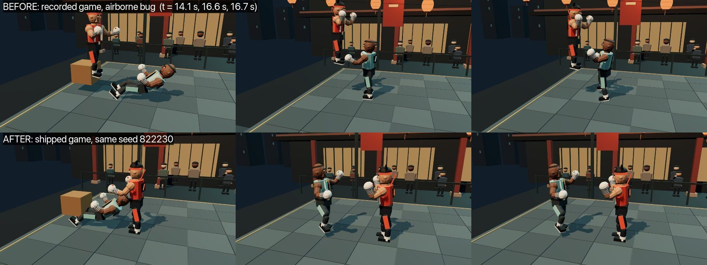
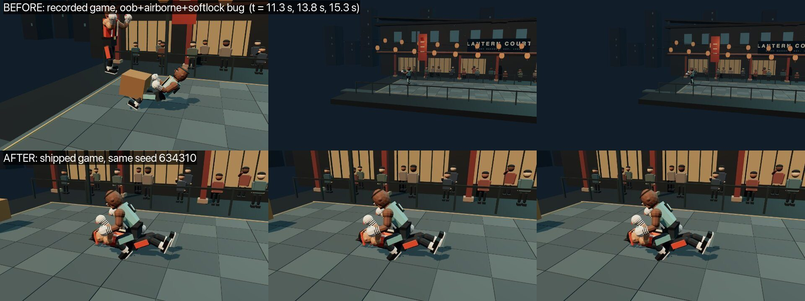
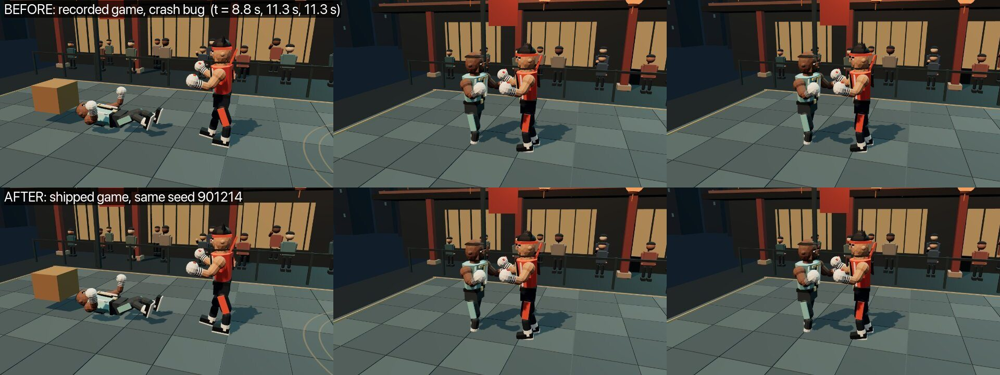
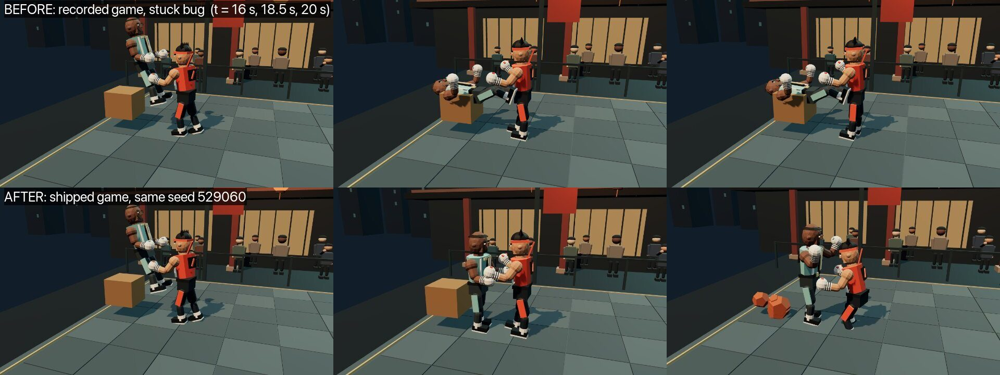

# Proof: bugs found, fixed, and replayed

A crowd of 1000 synthetic players played Market Brawl twice: the main run (2,831 rounds) and a separate sweep-nerf run with the same players and one balance patch (2,875 rounds). Across both, the engine flagged **four bug clusters (29 flagged rounds: 10 from the main run, 19 from the sweep-nerf run)**. Each one below is shown the same way: the **same seed and the same player**, replayed once with the build as it was recorded (fix off) and once with the shipped game (fix on). Frames are captured from the real 3D game replay; the numbers come from the engine. Regenerate with `node scripts/proof-table.mjs` and `npx tsx scripts/proof-gallery.ts` (the second needs `npm run dev -- -p 3150`).

The recorded replay links pin all five bug-fix flags and `rules.cpuLowBlock` to 0. Shipped replays use the five fixes and `rules.cpuLowBlock: 1`, a balance change; round outcomes may differ, but every flagged round must have zero bug events. Frame strips retain the earlier captures; the regenerated engine table and replay links use the current defaults.

## The numbers (engine, same seed and persona, before vs after)

| Bug | Rounds replayed | Bug events with the recorded build | Bug events with the shipped game |
|---|---|---|---|
| bug1 | 21 | 21 of 21 | 0 of 21 |
| bug2 | 4 | 4 of 4 | 0 of 4 |
| bug3 | 3 | 3 of 3 | 0 of 3 |
| bug4 | 1 | 1 of 1 | 0 of 1 |

Reading the table: **All 29 flagged rounds were replayed (21 bug1, 4 bug2, 3 bug3, 1 bug4); every one shows a bug event with the recorded build and none with the shipped game.** This is a replay of known seeds, not a proof of absence: the 65,000-round hunt in [`bug-hunt.md`](bug-hunt.md) found no game crash, NaN or crate escape on fresh seeds, but did find rarer cases under extreme tunings (documented there as H5 and H6).

## bug1: Fighter floats up after a mount release, throw or getup (`airborne`)

- Cluster size across both crowds: **21** rounds (7 from the main run, 14 from the sweep-nerf run). Shown: `p0009:3`, seed 822230. Fix off: 21 of 21 replayed rounds show the bug; fix on: 0 of 21.
- Fix in the shipped game: `mountReleaseFix`, `grabReleaseFix` and `getupCrateFix` (by hand). The last clears p0094:1, seed 501070 with sweep-nerf tuning: stale contacts at getup caused a sink-and-eject beside the right crate. Ultra's own patch fixed 0 of 8.
- Watch it: [before (recorded build)](https://a-thousand-players.vercel.app/replay?t=eyJzZWVkIjo4MjIyMzAsInR1bmluZyI6eyJydWxlcy5tb3VudFJlbGVhc2VGaXgiOjAsInJ1bGVzLnRocm93UHJvcEd1YXJkIjowLCJydWxlcy5ncmFiUmVsZWFzZUZpeCI6MCwicnVsZXMua25vY2tkb3duT25Qcm9wRml4IjowLCJydWxlcy5nZXR1cENyYXRlRml4IjowLCJydWxlcy5jcHVMb3dCbG9jayI6MH0sImZpZ2h0ZXIiOiJrYWkiLCJtYXhUIjoxNywicGVyc29uYSI6eyJpZCI6InAwMDA5IiwibmFtZSI6Ikl2YW4iLCJhcmNoZXR5cGUiOiJ0dXJ0bGUiLCJza2lsbCI6MC42NywicmVhY3Rpb25fdGlja3MiOjE4LCJwYXRpZW5jZSI6MC44MywiZnJ1c3RyYXRpb25fdG9sZXJhbmNlIjowLjc3LCJiaW8iOiI0OS15ZWFyLW9sZCBjaGVzcyBwbGF5ZXIsIHdhaXRzIGZvciByaXZhbCdzIG1pc3Rha2UsIG5ldmVyIGluaXRpYXRlcyBhdHRhY2suIiwicnVsZXMiOltdfX0) · [after (shipped game)](https://a-thousand-players.vercel.app/replay?t=eyJzZWVkIjo4MjIyMzAsInR1bmluZyI6e30sImZpZ2h0ZXIiOiJrYWkiLCJtYXhUIjoxNywicGVyc29uYSI6eyJpZCI6InAwMDA5IiwibmFtZSI6Ikl2YW4iLCJhcmNoZXR5cGUiOiJ0dXJ0bGUiLCJza2lsbCI6MC42NywicmVhY3Rpb25fdGlja3MiOjE4LCJwYXRpZW5jZSI6MC44MywiZnJ1c3RyYXRpb25fdG9sZXJhbmNlIjowLjc3LCJiaW8iOiI0OS15ZWFyLW9sZCBjaGVzcyBwbGF5ZXIsIHdhaXRzIGZvciByaXZhbCdzIG1pc3Rha2UsIG5ldmVyIGluaXRpYXRlcyBhdHRhY2suIiwicnVsZXMiOltdfX0)

## bug2: Fighter launched out of the arena after a mount release (`oob`, `airborne`, `softlock`)

- Cluster size across both crowds: **4** rounds (2 from the main run, 2 from the sweep-nerf run). Shown: `p0537:1`, seed 634310. Fix off: 4 of 4 replayed rounds show the bug; fix on: 0 of 4.
- Fix in the shipped game: `mountReleaseFix` (by hand, after Ultra failed twice).
- Watch it: [before (recorded build)](https://a-thousand-players.vercel.app/replay?t=eyJzZWVkIjo2MzQzMTAsInR1bmluZyI6eyJydWxlcy5tb3VudFJlbGVhc2VGaXgiOjAsInJ1bGVzLnRocm93UHJvcEd1YXJkIjowLCJydWxlcy5ncmFiUmVsZWFzZUZpeCI6MCwicnVsZXMua25vY2tkb3duT25Qcm9wRml4IjowLCJydWxlcy5nZXR1cENyYXRlRml4IjowLCJydWxlcy5jcHVMb3dCbG9jayI6MH0sImZpZ2h0ZXIiOiJrYWkiLCJtYXhUIjo5OSwicGVyc29uYSI6eyJpZCI6InAwNTM3IiwibmFtZSI6Ik1vbmEiLCJhcmNoZXR5cGUiOiJjYXN1YWwiLCJza2lsbCI6MC4yNCwicmVhY3Rpb25fdGlja3MiOjQwLCJwYXRpZW5jZSI6MC4xNSwiZnJ1c3RyYXRpb25fdG9sZXJhbmNlIjowLjM1LCJiaW8iOiJOaWdodCB3YXJkIG51cnNlLCBmaWdodHMgZm9yIGEgcXVpY2sgdGhyaWxsLCBxdWl0cyBpbW1lZGlhdGVseSBhZnRlciBiZWluZyBoaXQiLCJydWxlcyI6W3sicml2YWwiOiJhY3RpdmUiLCJ3ZWlnaHRzIjp7InB1bmNoIjo4fX0seyJ3ZWlnaHRzIjp7InJldHJlYXQiOjl9fV19fQ) · [after (shipped game)](https://a-thousand-players.vercel.app/replay?t=eyJzZWVkIjo2MzQzMTAsInR1bmluZyI6e30sImZpZ2h0ZXIiOiJrYWkiLCJtYXhUIjo5OSwicGVyc29uYSI6eyJpZCI6InAwNTM3IiwibmFtZSI6Ik1vbmEiLCJhcmNoZXR5cGUiOiJjYXN1YWwiLCJza2lsbCI6MC4yNCwicmVhY3Rpb25fdGlja3MiOjQwLCJwYXRpZW5jZSI6MC4xNSwiZnJ1c3RyYXRpb25fdG9sZXJhbmNlIjowLjM1LCJiaW8iOiJOaWdodCB3YXJkIG51cnNlLCBmaWdodHMgZm9yIGEgcXVpY2sgdGhyaWxsLCBxdWl0cyBpbW1lZGlhdGVseSBhZnRlciBiZWluZyBoaXQiLCJydWxlcyI6W3sicml2YWwiOiJhY3RpdmUiLCJ3ZWlnaHRzIjp7InB1bmNoIjo4fX0seyJ3ZWlnaHRzIjp7InJldHJlYXQiOjl9fV19fQ)

## bug3: Game crashes when a smashed crate is thrown (`RuntimeError: unreachable in throwProp`)

- Cluster size across both crowds: **3** rounds (all 3 from the sweep-nerf run). Shown: `p0233:2`, seed 901214. Fix off: 3 of 3 replayed rounds show the bug; fix on: 0 of 3.
- Fix in the shipped game: `throwPropGuard` (Ultra's patch, replay-verified 3 of 3).
- Watch it: [before (recorded build)](https://a-thousand-players.vercel.app/replay?t=eyJzZWVkIjo5MDEyMTQsInR1bmluZyI6eyJhbmltLlNXRUVQLnN0YXJ0dXAiOjAuMTQsImFuaW0uU1dFRVAuZGFtYWdlIjoxMSwicnVsZXMubW91bnRSZWxlYXNlRml4IjowLCJydWxlcy50aHJvd1Byb3BHdWFyZCI6MCwicnVsZXMuZ3JhYlJlbGVhc2VGaXgiOjAsInJ1bGVzLmtub2NrZG93bk9uUHJvcEZpeCI6MCwicnVsZXMuZ2V0dXBDcmF0ZUZpeCI6MCwicnVsZXMuY3B1TG93QmxvY2siOjB9LCJmaWdodGVyIjoicm9vayIsIm1heFQiOjEyLCJwZXJzb25hIjp7ImlkIjoicDAyMzMiLCJuYW1lIjoiQ2hlbiIsImFyY2hldHlwZSI6ImV4cGxvcmVyIiwic2tpbGwiOjAuNDUsInJlYWN0aW9uX3RpY2tzIjozMCwicGF0aWVuY2UiOjAuNjUsImZydXN0cmF0aW9uX3RvbGVyYW5jZSI6MC43NSwiYmlvIjoiMzEteWVhci1vbGQgQ2hpbmVzZSBjdXJpb3VzIHRpbmtlcmVyIHRlc3RpbmcgZXZlcnkgbWFya2V0IGdhZGdldC4iLCJydWxlcyI6W3siZGlzdCI6ImZhciIsInJpdmFsIjoiYWN0aXZlIiwid2VpZ2h0cyI6eyJwcm9wIjo1fX0seyJkaXN0IjoiY2xvc2UiLCJyaXZhbCI6InJlY292ZXJ5Iiwid2VpZ2h0cyI6eyJwdW5jaCI6Niwia2ljayI6NX19LHsicml2YWwiOiJkb3duIiwid2VpZ2h0cyI6eyJncmFiIjo3fX1dfX0) · [after (shipped game)](https://a-thousand-players.vercel.app/replay?t=eyJzZWVkIjo5MDEyMTQsInR1bmluZyI6eyJhbmltLlNXRUVQLnN0YXJ0dXAiOjAuMTQsImFuaW0uU1dFRVAuZGFtYWdlIjoxMX0sImZpZ2h0ZXIiOiJyb29rIiwibWF4VCI6MTIsInBlcnNvbmEiOnsiaWQiOiJwMDIzMyIsIm5hbWUiOiJDaGVuIiwiYXJjaGV0eXBlIjoiZXhwbG9yZXIiLCJza2lsbCI6MC40NSwicmVhY3Rpb25fdGlja3MiOjMwLCJwYXRpZW5jZSI6MC42NSwiZnJ1c3RyYXRpb25fdG9sZXJhbmNlIjowLjc1LCJiaW8iOiIzMS15ZWFyLW9sZCBDaGluZXNlIGN1cmlvdXMgdGlua2VyZXIgdGVzdGluZyBldmVyeSBtYXJrZXQgZ2FkZ2V0LiIsInJ1bGVzIjpbeyJkaXN0IjoiZmFyIiwicml2YWwiOiJhY3RpdmUiLCJ3ZWlnaHRzIjp7InByb3AiOjV9fSx7ImRpc3QiOiJjbG9zZSIsInJpdmFsIjoicmVjb3ZlcnkiLCJ3ZWlnaHRzIjp7InB1bmNoIjo2LCJraWNrIjo1fX0seyJyaXZhbCI6ImRvd24iLCJ3ZWlnaHRzIjp7ImdyYWIiOjd9fV19fQ)

*A crash is not visible in a still: the game stops responding at the crash time, so the two rows look alike up to that point. The proof for bug3 is the table above and the live replay links.*

## bug4: Knocked-down fighter stuck on a crate until the 99 s limit (`stuck`, `softlock`)

- Cluster size across both crowds: **1** round (from the main run). Shown: `p0653:2`, seed 529060. Fix off: 1 of 1 replayed rounds show the bug; fix on: 0 of 1.
- Fix in the shipped game: `knockdownOnPropFix` (by hand; Ultra's own patch worked on this seed but removes a height guard, so it was not shipped).
- Watch it: [before (recorded build)](https://a-thousand-players.vercel.app/replay?t=eyJzZWVkIjo1MjkwNjAsInR1bmluZyI6eyJydWxlcy5tb3VudFJlbGVhc2VGaXgiOjAsInJ1bGVzLnRocm93UHJvcEd1YXJkIjowLCJydWxlcy5ncmFiUmVsZWFzZUZpeCI6MCwicnVsZXMua25vY2tkb3duT25Qcm9wRml4IjowLCJydWxlcy5nZXR1cENyYXRlRml4IjowLCJydWxlcy5jcHVMb3dCbG9jayI6MH0sImZpZ2h0ZXIiOiJyb29rIiwibWF4VCI6OTksInBlcnNvbmEiOnsiaWQiOiJwMDY1MyIsIm5hbWUiOiJNaWd1ZWwiLCJhcmNoZXR5cGUiOiJjaGVlc2VyIiwic2tpbGwiOjAuMzQsInJlYWN0aW9uX3RpY2tzIjozOCwicGF0aWVuY2UiOjAuMSwiZnJ1c3RyYXRpb25fdG9sZXJhbmNlIjowLjY1LCJiaW8iOiJNZXhpY2FuIG1lY2hhbmljLCBtYXNoZXMgcHVuY2ggd2hlbiBwcmVzc3VyZWQuIiwicnVsZXMiOlt7InJpdmFsIjoiZG93biIsIndlaWdodHMiOnsicHVuY2giOjksImtpY2siOjR9fSx7IndlaWdodHMiOnsicmV0cmVhdCI6NiwianVtcCI6NX19XX19) · [after (shipped game)](https://a-thousand-players.vercel.app/replay?t=eyJzZWVkIjo1MjkwNjAsInR1bmluZyI6e30sImZpZ2h0ZXIiOiJyb29rIiwibWF4VCI6OTksInBlcnNvbmEiOnsiaWQiOiJwMDY1MyIsIm5hbWUiOiJNaWd1ZWwiLCJhcmNoZXR5cGUiOiJjaGVlc2VyIiwic2tpbGwiOjAuMzQsInJlYWN0aW9uX3RpY2tzIjozOCwicGF0aWVuY2UiOjAuMSwiZnJ1c3RyYXRpb25fdG9sZXJhbmNlIjowLjY1LCJiaW8iOiJNZXhpY2FuIG1lY2hhbmljLCBtYXNoZXMgcHVuY2ggd2hlbiBwcmVzc3VyZWQuIiwicnVsZXMiOlt7InJpdmFsIjoiZG93biIsIndlaWdodHMiOnsicHVuY2giOjksImtpY2siOjR9fSx7IndlaWdodHMiOnsicmV0cmVhdCI6NiwianVtcCI6NX19XX19)

## What this does and does not show

- The crowd found these bugs; **models did not fix most of them.** Ultra's patches fixed bug3 and worked on one bug4 seed; bug1 and bug2 were fixed by hand after Ultra failed (see the README).
- The fixes sit behind rule flags that are on in the shipped game and off in the recorded data, so recorded rounds still replay exactly (`node scripts/check-recorded-replays.mjs`: 45 of 45).
- The stills are one seed per bug. They illustrate the engine numbers; they are not a statistical claim.
